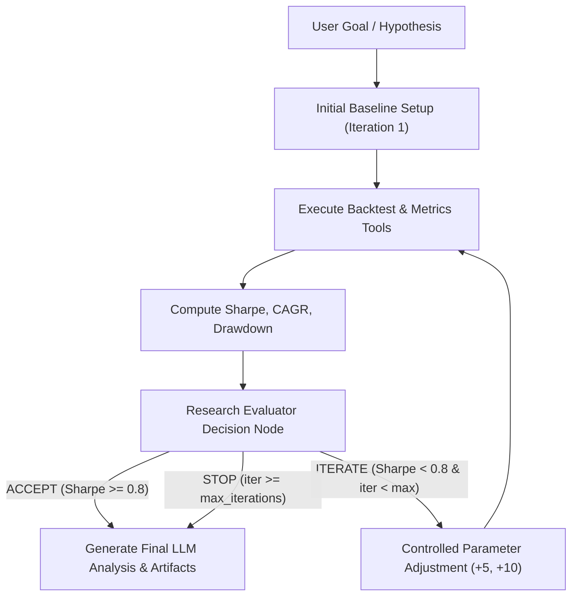

# Agentic Loop Engineering & Controlled Research Iteration

**Milestone Target:** 15-Aug-2026 (Core Feature)  
**Topic:** Loop Engineering in LangGraph Workflows  
**Project:** Equity Strategy Backtesting Engine (Shankh / Decuple Internship 2026-27 Project TE1)  

---

## 1. Executive Concept: What is Loop Engineering?

Instead of executing an agentic workflow in a single linear pass (Single-Shot Agent), **Loop Engineering** empowers the agent to evaluate its intermediate quantitative outputs against predefined criteria and perform controlled, bounded iterations before delivering the final report.

> **Presentation Summary:** *"Instead of executing the workflow once, the agent evaluates its result and can perform a controlled iteration before producing the final result."*

---

## 2. Why a Loop is Useful

1. **Self-Correction & Quality Control**: A single backtest may yield poor risk-adjusted returns (e.g. Sharpe < 0.5) due to sub-optimal initial parameters.
2. **Automated Hypothesis Testing**: The agent tests an initial quantitative hypothesis, evaluates performance against market standards, and refines the hypothesis systematically.
3. **Bounded Autonomy**: The loop automates trial-and-evaluation cycles while strict guardrails prevent infinite execution loops or compute waste.

---

## 3. The 5 Steps of the Research Loop

### Step 1: Initial Baseline Setup
- User provides a stock ticker (e.g. `INFY`) and baseline strategy (e.g. `SMA(20, 50)`).
- The agent initializes `iteration = 1` and runs the baseline backtest and metrics tool.

### Step 2: Intermediate Evaluation (Research Evaluator Node)
- Evaluates calculated metrics against target thresholds:
  - Target Sharpe Ratio >= `0.80`
  - Target CAGR >= `10.0%`
  - Target Maximum Drawdown <= `20.0%`

### Step 3: Controlled Parameter Iteration
- If target metrics are NOT met and `iteration < max_iterations`:
  - Parameter step adjustment is applied deterministically (e.g. increment SMA short window by +5, long window by +10).
  - Iteration counter increments (`iteration = iteration + 1`).

### Step 4: Stopping Conditions (Loop Termination Guardrails)
The loop terminates under any of the following explicit stopping conditions:
1. **Acceptance Threshold Met**: Sharpe >= 0.80 (Decision: `ACCEPT`).
2. **Maximum Iterations Ceiling**: Iteration counter reaches `max_iterations` (default: 3) (Decision: `STOP`).
3. **Execution Error / Missing Data**: Exception caught during tool execution (Decision: `FAIL`).

### Step 5: Final Artifact Generation
- Once stopped or accepted, the state transitions to `node_generate_artifacts` to run LLM analysis and render final equity charts.

---

## 4. Traceability & Audit Log

Every iteration retains full history in `state["experiment_history"]`:

| Iteration | Strategy | Parameters | Sharpe Ratio | CAGR | Max Drawdown | Evaluator Decision |
|---|---|---|---|---|---|---|
| 1 (Baseline) | SMA | short=20, long=50 | 0.62 | 7.8% | -18.2% | `ITERATE` |
| 2 (Adjusted) | SMA | short=25, long=60 | 0.84 | 12.1% | -14.1% | `ACCEPT` |

---

## 5. How Loop Engineering Differs from Uncontrolled Optimization

| Feature | Uncontrolled Parameter Sweep / Optimizer | Controlled Agentic Loop Engineering |
|---|---|---|
| **Approach** | Brute-force tests 10,000+ parameter grid combinations | Bounded, multi-step agent reasoning with explicit stopping limits |
| **Overfitting Risk** | Extremely high (finds spurious random peaks) | Very low (strictly bounded iterations with fixed step size) |
| **Explainability** | Black-box numerical output | Fully traceable state graph decision audit trail |
| **LLM Role** | None (pure numerical loop) | Evaluates context, logs reasoning, and interprets intermediate states |
