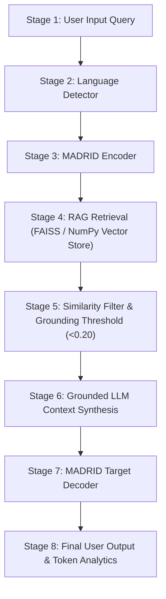

# QUANTLAB RAG Architecture

## Overview
QUANTLAB features an 8-Stage Multilingual Retrieval-Augmented Generation (RAG) Architecture designed for high-precision quantitative finance Q&A and research interpretation.

## Key Components
1. **Document Loader & Metadata Extractor (`src/rag/loader.py`)**: Recursively ingests Markdown documentation across 10 structured domain directories in `knowledge_base/` and attaches metadata (source, category, topic, section, version).
2. **Configurable Chunker (`src/rag/chunker.py`)**: Splits documents into semantically coherent text chunks based on section headers (`##`) and paragraph boundaries with configurable `chunk_size` and `chunk_overlap`.
3. **Embedding Engine (`src/rag/embeddings.py`)**: Vectorizes chunks using `SentenceTransformers` (`all-MiniLM-L6-v2`) or normalized TF-IDF vectorization fallback.
4. **Vector Store Manager (`src/rag/vector_store.py`)**: FAISS L2 vector index manager (with NumPy fallback) supporting `build_index`, `search`, `clear_index`, and score normalization `[0.0, 1.0]`.
5. **Grounded RAG Chain (`src/rag/rag_chain.py`)**: Integrates the 8-stage pipeline, computes stage latencies, enforces similarity thresholds (`<0.20` returns ungrounded warning), and logs requests safely.
