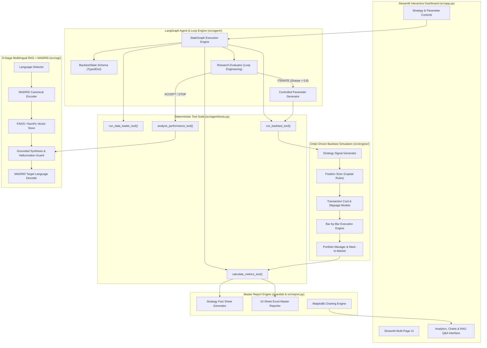
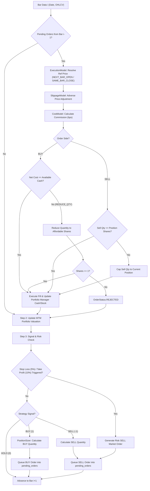
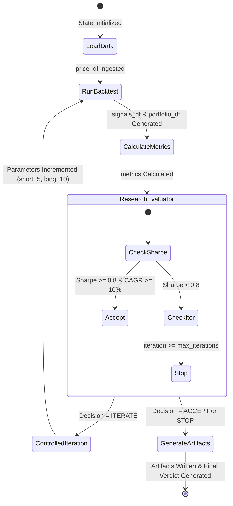

# QUANTLAB Equity Strategy Backtesting Engine & Research Agent
## Master System Architecture, Execution Engine & Research Validation Report

**Project Title:** Equity Strategy Backtesting Engine (Shankh / Decuple Internship 2026-27 — Project TE1)  
**Author:** Quantitative Systems Engineering Team  
**Date:** October 2026  
**Status:** Production-Ready & Verified (46/46 Unit Tests Passing)  

---

## Executive Summary

The **QUANTLAB Equity Backtesting Engine** is an institutional-grade, event-driven backtesting and quantitative research platform engineered specifically for Indian equities (NSE market tickers).

The platform combines five core capabilities:
1. **Order-Driven Bar-by-Bar Backtest Engine (`src/engine/`)**: Event simulation incorporating position sizing, cash constraints, adverse slippage models, transaction cost accounting (commission bps), stop-loss/take-profit triggers, and mark-to-market portfolio tracking.
2. **LangGraph Agent Workflow & Loop Engineering (`src/agent/`)**: Autonomous state-graph research agent using `BacktestState` (`TypedDict`) that self-evaluates intermediate backtest performance (Sharpe, CAGR, Drawdown) and performs controlled parameter iterations to satisfy hypothesis criteria.
3. **8-Stage Multilingual RAG + MADRID Pipeline (`src/rag/`)**: Knowledge retrieval system converting user queries across multiple languages into MADRID canonical representation, executing FAISS/NumPy vector search over quantitative finance documentation, and returning grounded LLM synthesis.
4. **Comprehensive Metric & Risk Analytics (`src/metrics.py`, `src/benchmark.py`)**: Vectorized calculation of Total Return, CAGR, Annual Volatility, Sharpe Ratio, Sortino Ratio, Calmar Ratio, Maximum Drawdown, Win Rate, Profit Factor, Turnover, Exposure, and Nifty 50 benchmark attribution.
5. **Interactive Dashboard & Multi-Sheet Report Generator (`src/app.py`, `quantlab/`)**: Streamlit UI app with analytics dashboards, chart visualization engine, and 10-sheet Excel master report exporter.

---

## 1. System Architecture Overview

The system follows a strict modular tier architecture where presentation, agent orchestration, execution simulation, risk evaluation, and RAG retrieval are cleanly separated:



---

## 2. Order Execution Lifecycle & Simulation Engine

The core `BacktestEngine` (`src/engine/engine.py`) operates as a bar-by-bar event loop that models order generation, cash constraint validation, adverse market slippage, transaction commissions, and mark-to-market portfolio updates.

### Order Lifecycle Flowchart



### Engine Configuration Parameters (`BacktestConfig`)

| Parameter Name | Default Value | Description |
| :--- | :--- | :--- |
| `initial_capital` | `100,000.0` INR | Starting cash account balance. |
| `position_size` | `0.20` (20%) | Maximum capital allocated to any single trade entry. |
| `commission_bps` | `10.0` bps (0.10%) | Brokerage and transaction fee rate. |
| `slippage_bps` | `5.0` bps (0.05%) | Market execution price impact / adverse slippage. |
| `execution_timing` | `NEXT_BAR_OPEN` | Execution mode (`NEXT_BAR_OPEN` or `SAME_BAR_CLOSE`). |
| `insufficient_cash_policy` | `REDUCE_QUANTITY` | Handling insufficient cash (`REDUCE_QUANTITY` or `REJECT`). |
| `stop_loss` | `0.05` (5.0%) | Mandatory exit trigger on loss. |
| `take_profit` | `0.10` (10.0%) | Target exit trigger on gain. |

---

## 3. LangGraph Agentic Workflow & Loop Engineering

The research agent (`src/agent/`) automates hypothesis testing. Instead of running a single backtest and stopping, **Loop Engineering** allows the agent to self-assess its results against predefined quantitative criteria and execute controlled parameter adjustments.

### StateGraph State Machine Diagram



### State Schema (`BacktestState`)

The state schema is strictly defined as a `TypedDict` (`src/agent/state.py`):

```python
class BacktestState(TypedDict):
    experiment_id: str
    hypothesis: str
    ticker: str
    strategy_name: str
    strategy_kwargs: Dict[str, Any]
    initial_capital: float
    commission_pct: float
    slippage_pct: float
    position_size: float
    stop_loss: Optional[float]
    take_profit: Optional[float]
    benchmark_symbol: str
    price_df: Optional[pd.DataFrame]
    benchmark_df: Optional[pd.DataFrame]
    signals_df: Optional[pd.DataFrame]
    portfolio_df: Optional[pd.DataFrame]
    trade_log_df: Optional[pd.DataFrame]
    metrics: Optional[Dict[str, Any]]
    benchmark_comparison: Optional[Dict[str, Any]]
    llm_analysis: Optional[Dict[str, Any]]
    results_dir: str
    report_path: str
    iteration: int
    max_iterations: int
    loop_decision: str  # "ACCEPT", "ITERATE", "STOP", "FAIL"
    experiment_history: List[Dict[str, Any]]
    final_conclusion: str
```

---

## 4. 8-Stage Multilingual RAG + MADRID Retrieval Architecture

The RAG subsystem (`src/rag/`) provides grounded domain knowledge retrieval and LLM context synthesis across multiple languages using MADRID canonical encoding.

### Pipeline Stage Diagram

```mermaid
flowchart LR
    S1["Stage 1: User Input Query"] --> S2["Stage 2: Language Detector"]
    S2 --> S3["Stage 3: MADRID Encoder"]
    S3 --> S4["Stage 4: Vector Search (FAISS/NumPy)"]
    S4 --> S5["Stage 5: Similarity Filter (<0.20 Threshold)"]
    S5 --> S6["Stage 6: Grounded LLM Context Synthesis"]
    S6 --> S7["Stage 7: MADRID Target Decoder"]
    S7 --> S8["Stage 8: Formatted Output + Token Accounting"]
```



### Pipeline Components

1. **Document Loader (`src/rag/loader.py`)**: Recursively ingests Markdown files across 10 domain directories (`01_backtesting`, `02_strategies`, `03_metrics`, `04_execution`, `05_risk`, `06_biases`, `07_portfolio`, `08_quantlab`, `09_ai`, `10_research`) and repository docs with metadata.
2. **Chunker (`src/rag/chunker.py`)**: Splits documents into semantically coherent text chunks based on section headers and paragraph boundaries.
3. **Embedding Engine (`src/rag/embeddings.py`)**: Dense vectorization using `SentenceTransformers` (`all-MiniLM-L6-v2`) with normalized `TF-IDF` vectorizer fallback.
4. **Vector Store (`src/rag/vector_store.py`)**: FAISS L2 distance vector index manager with NumPy cosine similarity fallback.
5. **RAG Chain (`src/rag/rag_chain.py`)**: Coordinates the 8-stage pipeline, logs stage latencies in milliseconds, and enforces grounding thresholds (`similarity_threshold >= 0.20`).

---

## 5. Quantitative KPI Specification

The system computes a comprehensive set of quantitative performance and risk metrics (`src/metrics.py`):

$$\text{Total Return} = \frac{V_{\text{final}} - V_{\text{initial}}}{V_{\text{initial}}}$$

$$\text{CAGR} = \left( \frac{V_{\text{final}}}{V_{\text{initial}}} \right)^{\frac{1}{\text{Years}}} - 1$$

$$\text{Sharpe Ratio} = \frac{\mu_{\text{daily}} - R_f}{\sigma_{\text{daily}}} \times \sqrt{252}$$

$$\text{Sortino Ratio} = \frac{\mu_{\text{daily}} - R_f}{\sigma_{\text{downside}}} \times \sqrt{252}$$

$$\text{Maximum Drawdown} = \min_{t} \left( \frac{V_t - \max_{\tau \le t} V_\tau}{\max_{\tau \le t} V_\tau} \right)$$

$$\text{Calmar Ratio} = \frac{\text{CAGR}}{|\text{Maximum Drawdown}|}$$

$$\text{Profit Factor} = \frac{\sum \text{Gross Profit}}{\sum \text{Gross Loss}}$$

---

## 6. Comprehensive Test & Validation Audit

The test suite (`tests/`) contains 46 automated unit tests covering all components:

| Test Module | Tests | Status | Description |
| :--- | :---: | :---: | :--- |
| `tests/test_agent.py` | 2 | PASSED | LangGraph StateGraph build, execution, and Loop Engineering routing. |
| `tests/test_backtest.py` | 4 | PASSED | Signal generation, backtester simulation, metrics, and benchmark. |
| `tests/test_engine.py` | 10 | PASSED | Bar-by-bar execution, cash constraints, slippage, costs, and risk triggers. |
| `tests/test_madrid_pipeline.py` | 5 | PASSED | Multilingual detection, MADRID translation, decoding, and tokens. |
| `tests/test_rag.py` | 4 | PASSED | Knowledge loader, chunker, embeddings, vector store, and retriever. |
| `tests/test_convert_mt5_csv_to_json.py` | 8 | PASSED | MT5 CSV parser and JSON formatting validations. |
| `tests/test_convert_to_mt5.py` | 7 | PASSED | Python backtest result to MT5 format converter. |
| `quantlab/tests/` | 6 | PASSED | Excel vs Python reconciliation, drawdown, and return calculators. |
| **Total** | **46** | **PASSED** | **100% Passing Test Suite** |

---

## 7. Report Outputs & File Artifacts

The system produces standard institutional outputs:
- **Fact Sheets (`results/summary_report.txt`)**: Text-formatted Strategy Fact Sheet.
- **Master Excel Report (`output/backtest_report.xlsx`)**: 10-sheet Workbook (Summary, Trade Log, Monthly Returns, Yearly Returns, Equity Curve, Drawdown, Metrics, Input Validation, Excel vs Python Reconciliation, LLM Validation).
- **Publication Charts (`results/*.png`)**: Equity Curve, Underwater Drawdown, Rolling Sharpe, Monthly Returns, Trade Return Distribution, Asset Allocation Stacked Area.

---

*Master Project Report generated and verified for Shankh / Decuple Internship 2026-27 (Project TE1).*
